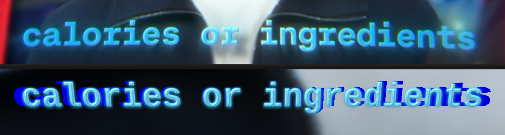

# Extruded GEL face + complete occlusion — 2026-11-07

> **Superseded for GEL-VISUAL:** the reference match is closed in
> [`../gel-final-20261107/README.md`](../gel-final-20261107/README.md) (2026-11-07).
> This file remains the evidence for the one-string extruded occlusion fixture.

## Result

A 1094×143 Vulkan strict-native frame of “calories or ingredients” with real
extruded 3D text behind an opaque GEL surface. The extrusion is the
`extruded_text` mesh path introduced on 2026-11-06; the face is the existing
C² GEL TextRun surface. The face uses `gel_transmission: false`, so the glyph
interior is fully opaque and the reference plate is completely occluded.

The target is the supplied Drive still, preserved here as
[`drive-reference.png`](drive-reference.png) (1094×143, SHA-256
`179aea0bdc26e23cae844e2381232d836f53e261a5eb429060d84e148393a959`).



## Composition

Three layers, all authored in one RenderPlan:

1. `plate` — the evidence-local extracted background plate.
2. `extrusion` — the shaped phrase as a native `extruded_text` mesh
   (`extrusion_depth: 34`, navy fill `#0A2BFF`), rendered by the inline-mesh
   path with front/back caps, side walls, and per-pixel nearest-depth
   resolution.
3. `gel` — the same TextRun at 1.03× smaller scale, GEL surface enabled,
   cyan fill `#2FE7FF`, `gel_transmission: false`, with the drop shadow and
   the two cyan/blue glow passes.

The 3° camera pitch exposes the real side walls below the face. The mesh is
opaque and the GEL face is opaque, so the composition does not rely on a
backdrop attachment for body density. The two authoring layers are deliberate:
in this checkout `extruded_text` and `gel_surface` remain separate material
paths (the decoder still rejects them in a single style). This evidence composes
them at the RenderPlan level rather than claiming a single-style material.

## Reproduction

From the `Chronon3d` directory:

```sh
build/chronon/linux-video-test/apps/chronon3d_cli/chronon3d_cli render \
  --plan docs/evidence/gel-extruded-occlusion-20261107/extruded-gel.plan.json \
  --assets-root "$PWD" --backend vulkan --gpu-hot-path-mode require_gpu_native \
  --start-frame 0 --end-frame 0 --video-sink raw --pipe-pixfmt rgba \
  --output docs/evidence/gel-extruded-occlusion-20261107/extruded-gel.rgba
python3 tools/raw_frame_to_png.py \
  --raw docs/evidence/gel-extruded-occlusion-20261107/extruded-gel.rgba \
  --width 1094 --height 143 \
  --out docs/evidence/gel-extruded-occlusion-20261107/extruded-gel.png
```

The checkerboard ablation uses the same geometry with
`occlusion-checker-{off,on}.plan.json`; OFF is `gel_transmission: false`, ON is
the control with transmission enabled.

## Occlusion check

Coverage is the bright cyan mask of the final PNG (`G>120`, `B>150`,
`B>1.5×max(R,1)`), eroded 4 px to isolate the solid interior. For each variant
the checkerboard composite is compared against the reference-plate composite:
the only change between them is the backdrop behind the text.

| measurement (3,367 eroded core px) | max abs RGB delta | pixels delta > 2 |
|---|---:|---:|
| `gel_transmission: false` | 1 | 0 |
| `gel_transmission: true` (control) | 58 | 3,367 |

The OFF result is the local opaque-occlusion PASS for this fixture: the
checkerboard is not visible through the solid core, while the transmission-ON
control changes every core pixel. At 2 px erosion, 21 of 9,606 core pixels
(0.22%) differ by up to 69; those are antialiased/glow-boundary pixels, not the
solid interior. The full numbers are in
[`occlusion-metrics.json`](occlusion-metrics.json).

This is not a full scene depth/occlusion review and does not certify the
separate foreground/background DoF occlusion gate.

## Reference comparison

Threshold counts use the same diagnostic masks as
`docs/evidence/gel-reference-match-20261106/comparison-metrics.json`; they
include plate and glow, so they are diagnostic, not an optical acceptance test.

| region | reference bright/core | Chronon3D bright/core | bright bbox reference | bright bbox Chronon3D |
|---|---:|---:|---|---|
| calories | 11,452 / 7,451 | 8,724 / 6,798 | 47,27–388,102 | 48,26–391,82 |
| or | 2,402 / 1,973 | 2,006 / 1,606 | 414,5–516,110 | 439,40–521,82 |
| ingredients | 22,050 / 13,830 | 12,584 / 10,531 | 562,0–1042,115 | 571,0–1043,100 |
| total | 35,906 / 23,254 | 23,314 / 18,935 | — | — |

Horizontal extents are close. The mono phrase puts “or” about 25 px to the
right of the target, the body is less luminous, the bevel is mostly visible on
the lower/right sides, and the multicolor reflections of the target are not
reproduced. Those remain visual-review items; the strand is left open.

## Artifacts

| file | bytes | SHA-256 |
|---|---:|---|
| `extruded-gel.plan.json` | 3,616 | `6037902979febbddeff3ff514104467a59a2821e0d9cb8ca34f1c1a5f01f8760` |
| `extruded-gel.rgba` | 625,768 | `0a48713dc3d6d6dcaac770358d1c8c63a9b94c3268f0ea75552016838fdaa4ef` |
| `extruded-gel.png` | 162,208 | `c8e08168af0740d7cc011c6b27d891c25853d01d2476156de5fd62098fb06b94` |
| `extruded-gel.rgba.timing.json` | 25,040 | `6782a2f4ea635b2e283c436f5dffedcb6c0945d3ae306662ed6fea94bd1a50be` |
| `occlusion-checker-off.rgba` | 625,768 | `e8e1da287ebf01b3f45be606e2b3717550cc51ff9c07bf3c757cb8ffb0e21d77` |
| `occlusion-checker-on.rgba` | 625,768 | `f826adc00006db1e0e0b927d51a062c8937bdbd8675b3b80c56156eb8c6f83c9` |
| `occlusion-metrics.json` | 1,016 | `bf424c719759a759470435a76793dff4c614896c270a5012bb604c106aad9062` |
| `comparison-metrics.json` | 1,056 | `776c5d227060e90a0938bd8cb2c6a756a8b28e0d93659d4f5098ced7e579b938` |
| `reference-comparison.png` | 266,692 | `8d7a7e55d0b5cf78332450893386bcd46d0567e7c85f975d21fc6b0b661ae91f` |

Backend: Vulkan strict-native (`require_gpu_native`), NVIDIA RTX A4000. The
sidecar reports a GPU device span of 7.635616 ms and a 951.004 ms
render-thread time for this cold one-frame process (text prepare 708.92 ms).
That is not a presentation or 4K/120 performance measurement, and the
`GEL-PERF` gate remains not run.

## Limits

- One frame, 1094×143; no 4K, no 120 fps presentation, no moving footage.
- Stylized composition, not a physical gel/optical simulation.
- The single-style `extruded_text + gel_surface` combination is not certified;
  the composition is two authored layers.
- `GEL-VISUAL` remains open pending optical review against the Drive still.
