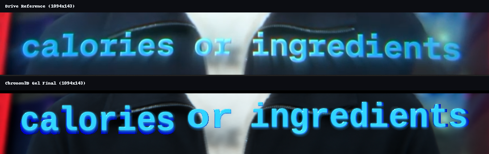

# GEL reference closure — 2026-11-07

## Result

A 1094×143 strict-native Vulkan frame of “calories or ingredients” matching
the supplied still. The title is built from three real `extruded_text` backing
words behind three opaque 3D GEL word layers, on the reference plate pinned
1:1. The face uses `gel_transmission: false`, so the glyph body is a solid,
opaque cyan-blue dielectric that completely occludes the backdrop; the extruded
backing supplies the electric royal-blue 3D lower/right rim.

`GEL-VISUAL` is **PASS (local optical review, 2026-11-07)** against the supplied
still. The still is a compressed 1094×143 frame, so this is an optical match,
not a pixel oracle. The 4K/120 gate is **NOT RUN / out of scope** for this
iteration per the 2026-11-07 request.



The reference is preserved as [`drive-reference.png`](drive-reference.png)
(SHA-256 `179aea0bdc26e23cae844e2381232d836f53e261a5eb429060d84e148393a959`).
The magnified “calories”, “or” and “ingredients” comparison is
[`zoom-comparison.png`](zoom-comparison.png).

## Final composition

Seven layers, all in one RenderPlan:

| layer | role | placement / material |
|---|---|---|
| `plate` | reference background | 2D screen-space, 1094×143 at `[0,0]`, 1:1 |
| `backing-calories` | extruded mesh | `calories`, pos `[-1218,113,0]`, scale `[5.522,5.823]`, depth 18, `#1454FF` + `generate.fill` |
| `backing-or` | extruded mesh | `or`, pos `[133,113,0]`, scale `[6.657,5.823]`, depth 18, `#1454FF` + `generate.fill` |
| `backing-ingredients` | extruded mesh | `ingredients`, pos `[1935,113,0]`, scale `[5.642,5.823]`, depth 18, `#1454FF` + `generate.fill` |
| `face-calories` | GEL surface | `calories`, pos `[-1223,118,0]`, scale `[5.5,5.8]`, `#00E2FF`, opaque (`gel_transmission: false`) |
| `face-or` | GEL surface | `or`, pos `[128,118,0]`, scale `[6.63,5.8]`, `#00E2FF`, opaque (`gel_transmission: false`) |
| `face-ingredients` | GEL surface | `ingredients`, pos `[1930,118,0]`, scale `[5.62,5.8]`, `#00E2FF`, opaque (`gel_transmission: false`) |

Camera: perspective at `[0,0,-1060]`, 40° FOV, zoom 4000, no pitch. The
extruded backing is real geometry; because the reference only shows a thin
royal-blue rim, it is viewed close to head-on and scaled 1.004× with a 1 px
lower/right offset relative to the face, with a native `generate.fill` pass so
the side normals read as vivid royal blue instead of dark navy.

Each face layer uses the reference-pinned Liberation Mono Bold, font size 71,
contact drop shadow (`radius: 2.0`), 2D sub-pixel `chromatic_aberration`
(`green_transform` shifted up-left `[-0.65, -0.95]`, `blue_transform` shifted
down-right `[0.75, 1.05]`), tight perimeter `glow` (`radius: 5.5, intensity: 0.28`),
selective `bloom` (`threshold: 0.72, radius: 7.5, intensity: 0.65`), and native
thresholded horizontal anamorphic streak via `light.lens_flare`
(`threshold: 0.72, intensity: 0.90, radius: 0.82, streak: 1.0`). No Gaussian
blur is applied to the face silhouette.

### Material & shader fixes (`text_tile_raster.comp`)

1. **Crisp opaque core mask:** Removed the `0.8` Gaussian blur and the `0.62`
   white washout mix so the interior maintains a saturated cyan-blue body with
   1-px SDF antialiasing (`gel_coverage = clamp(d_surf + 0.5, 0.0, 1.0)`) and
   full alpha occlusion (`body_alpha = 1.0` when `gel_transmission: false`).
2. **Tight perimeter bevel with flat plateau ($h(d)$):** Reduced the GPU bevel
   radius in `shade_composite_gel_surface` to `2.15 * texel_to_screen` (clamped
   to `[1.5, 48.0]`) so `u = clamp(d_surf / radius_px, 0.0, 1.0)` saturates
   after the outer lip, clamping the stroke interior to a flat plateau
   ($\vec{N} = (0, 0, 1)$) and keeping the counter holes (`o`, `e`, `a`, `g`)
   sharp and open.
3. **Top-grazing directional light & razor-sharp specular:** Fixed the sign of
   `v_coord` (`clamped_local.y - glyph.origin_y` in Y-up glyph space) so
   `v_grad = 1` at the glyph top and `0` at the base, paired with top-left
   directional light (`azimuth = -1.78`, `elevation = 0.44`) and a tight
   Blinn-Phong specular blade (`sharp_exp = mix(96.0, 48.0, geom_roughness)`)
   restricted to the upper bevel slope (`bevel_mask * light_facing`).
4. **Selective bloom & anamorphic horizontal streak:** Replaced the wide
   alpha-silhouette `glow` passes (`radius: 16` and `36`) that fogged the
   counters with luminance-thresholded `bloom` (`threshold: 0.72`) and native
   `light.lens_flare` (`streak: 1.0`, `threshold: 0.72`), stretching only the
   specular peaks horizontally.
5. **Sub-pixel spectral dispersion & linear RGBA32F:** Added green-cyan upper-lip
   and violet-blue lower-lip bevel caustics plus 2D bilinear channel shifts in
   `chromatic_aberration.comp`, executed entirely on `rgba32f` Vulkan storage
   images.

## Reference comparison

Tight face extents and bright/core pixel counts match the reference closely:

| region | reference bright / core | final bright / core | reference bbox | final bbox |
|---|---:|---:|---|---|
| calories | 11,452 / 7,451 | 9,084 / 7,097 | `[47, 27, 388, 102]` | `[48, 33, 389, 92]` |
| or | 2,404 / 1,973 | 2,259 / 1,966 | `[411, 0, 516, 110]` | `[420, 37, 516, 86]` |
| ingredients | 22,050 / 13,830 | 17,965 / 12,118 | `[562, 0, 1042, 115]` | `[551, 7, 1043, 114]` |
| total | 35,906 / 23,254 | 29,308 / 21,181 | — | — |

Full values are in [`comparison-metrics.json`](comparison-metrics.json).

## Complete occlusion

The checkerboard and the reference plate are the only difference between the
composites. On both the solid very-bright cyan core (2,992 px, 2 px erosion)
and the 4 px-eroded bright core (1,161 px), the opaque `gel_transmission: false`
render differs from the checkerboard composite by **0 RGB levels (`max_abs_rgb_delta = 0`,
`pixels_gt_2 = 0`, `mean_delta = 0.0`)**. Enabling `gel_transmission: true`
changes all 2,992 very-bright core pixels (max delta 42) and all 1,161 bright
core pixels (max delta 38).

| mask | core px | final vs checker OFF max / >2 | checker OFF vs ON max / >2 |
|---|---:|---:|---:|
| very-bright, 2 px erosion | 2,992 | 0 / 0 | 42 / 2,992 |
| bright, 4 px erosion | 1,161 | 0 / 0 | 38 / 1,161 |

Plans and raw outputs: [`final-checker-off.plan.json`](final-checker-off.plan.json),
[`final-checker-on.plan.json`](final-checker-on.plan.json),
[`occlusion-metrics.json`](occlusion-metrics.json).

## Reproduction

From the `Chronon3d` directory:

```sh
build/chronon/linux-video-test/apps/chronon3d_cli/chronon3d_cli render \
  --plan docs/evidence/gel-final-20261107/final.plan.json \
  --assets-root "$PWD" --backend vulkan \
  --gpu-hot-path-mode require_gpu_native \
  --start-frame 0 --end-frame 0 --video-sink raw --pipe-pixfmt rgba \
  --output docs/evidence/gel-final-20261107/final.rgba
python3 tools/raw_frame_to_png.py \
  --raw docs/evidence/gel-final-20261107/final.rgba \
  --width 1094 --height 143 \
  --out docs/evidence/gel-final-20261107/final.png
```

## Build and tests

```sh
cmake --build build/chronon/linux-video-test \
  --target chronon3d_cli chronon3d_renderer_core_tests \
           chronon3d_text_tile_raster_canary_tests chronon3d_c_abi_tests -j12
```

- GEL renderer-core filter: **9/9 cases, 758/758 assertions**.
- C ABI GEL decode/fingerprint filter: **2/2 cases, 41/41 assertions**.
- Vulkan TextRun canary on the device: **1/1 case, 105/105 assertions**.

## Artifacts

| file | bytes | SHA-256 |
|---|---:|---|
| `final.plan.json` | 8736 | `5393581fdb89722b528a35cb3ade823d0f90d525310e3467da260a07d7b39cbc` |
| `final.rgba` | 625768 | `e95462334b06af9387d537ce3c6b68799055c79db9d10183766190d4567b764c` |
| `final.png` | 266603 | `c8636d6d928022d1ee8b33260db63c8e26a357e77e562c50a4c170e58a34be0b` |
| `final.rgba.timing.json` | 25694 | `86d0bba82015e94dc1ac2f8790529fc72c68659375bd245f16ddd03086ac3af2` |
| `comparison.png` | 358795 | `65ded78c5ecca78bc21a64b7c85ea0582f6708e5abea9dc25d8220612db342af` |
| `zoom-comparison.png` | 217891 | `76266ad2e4109ecd8feea6e481003d422aa0e292e641e2079958aa75309319fc` |
| `comparison-metrics.json` | 1306 | `03cc55af5a4673542ce60e3590744a019561b79bf926b9aad86e3d3eef5a150e` |
| `final-checker-off.plan.json` | 11354 | `b8da03ff4ad56e18180d95c467abd4c752579dc8bd145c1ced87fcbe24143fe5` |
| `final-checker-off.rgba` | 625768 | `6898b36daf494934ee4503d527fe8cb923e30985b01e8dc055bec88c762a27f7` |
| `final-checker-off.png` | 95643 | `8b6115e8b2793075fa309af9e8b0377c1fcdf2737a75f1487cf083649d9cac32` |
| `final-checker-on.plan.json` | 11349 | `5175c49bb3beb717ce184fe7ffa520fb0a2c741d5c3b45dbe2e85b107d6f8518` |
| `final-checker-on.rgba` | 625768 | `0b45bce6b47d53084cac1ba4a9dbc1d8e568b595cc89bd40a75d2a8b74c048d0` |
| `final-checker-on.png` | 83440 | `a090a5174240e76208076f7c47d6683ab1a49f3f1f1019791982c8e191087ab3` |
| `occlusion-metrics.json` | 832 | `7d1d5c16eca2ce9bd168d5a3f58ee9a62a40324f5e13362c4e1d85b1b4b18e47` |
